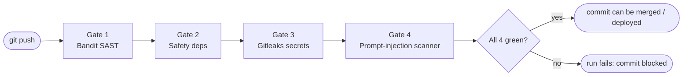
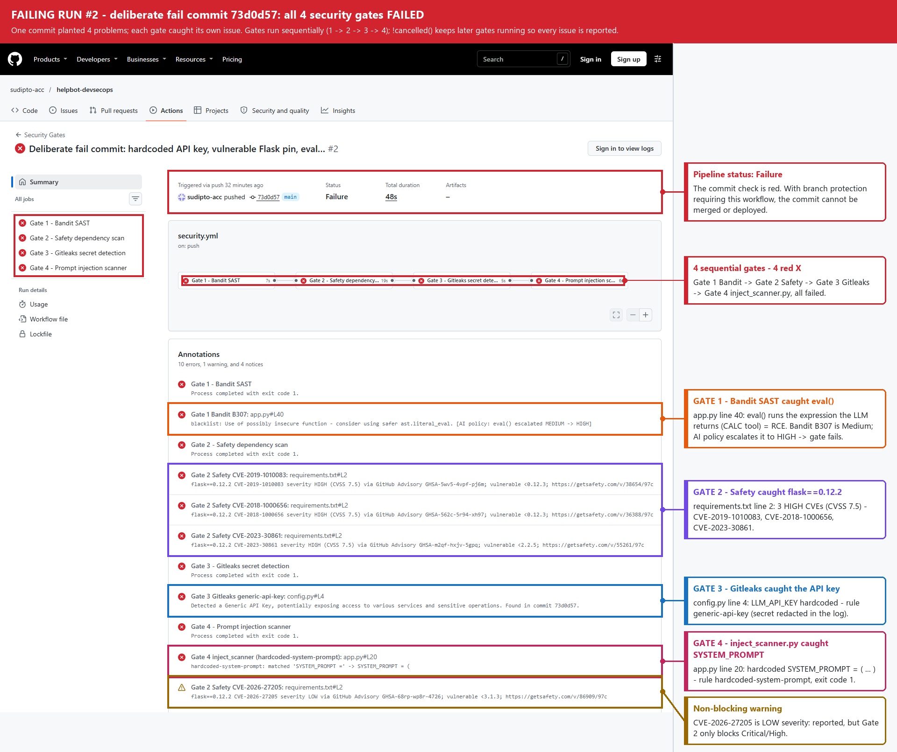
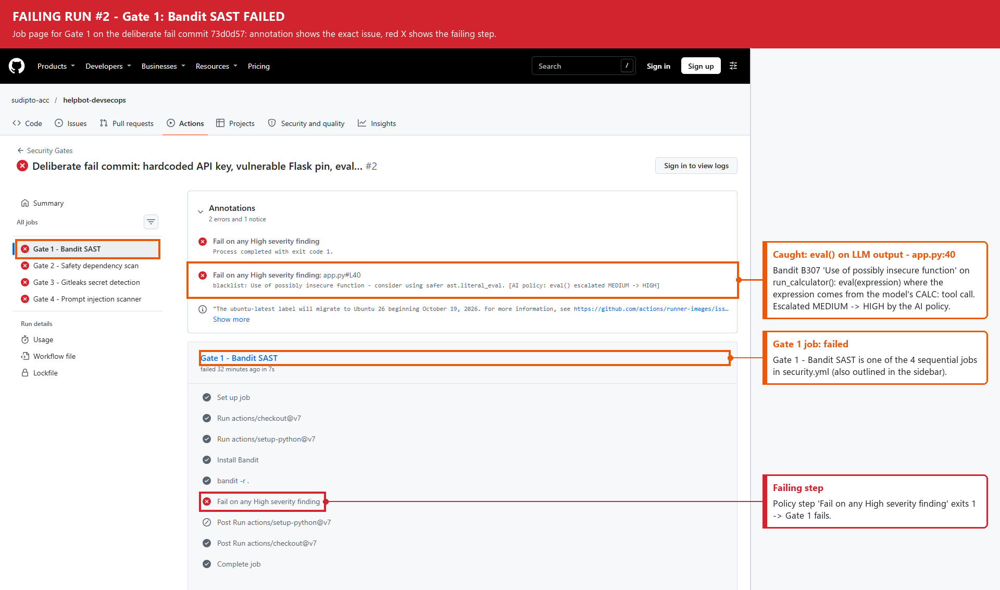
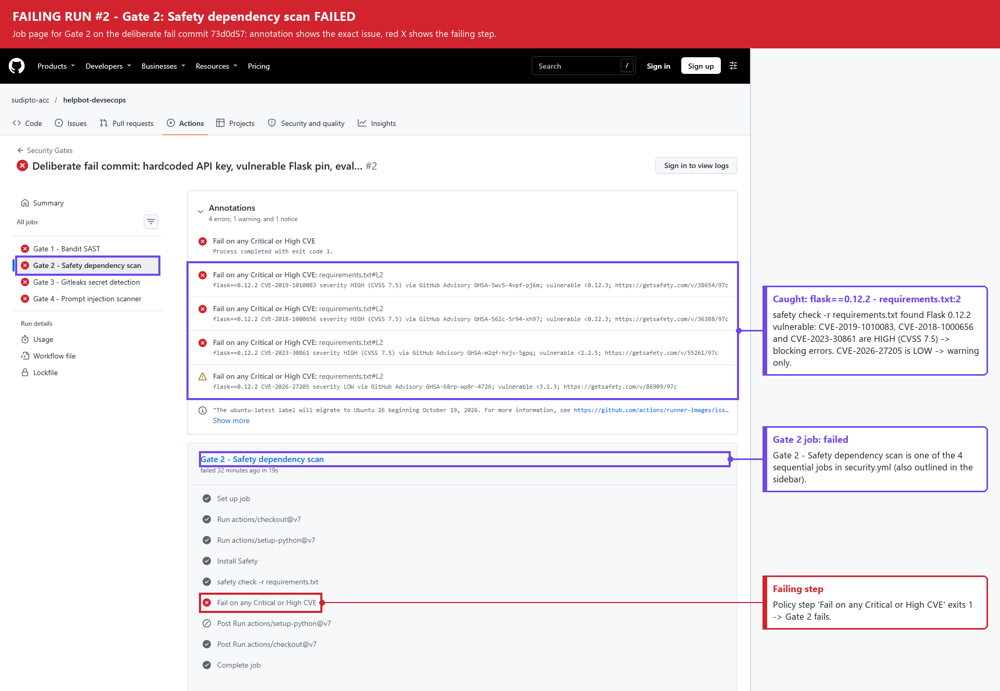
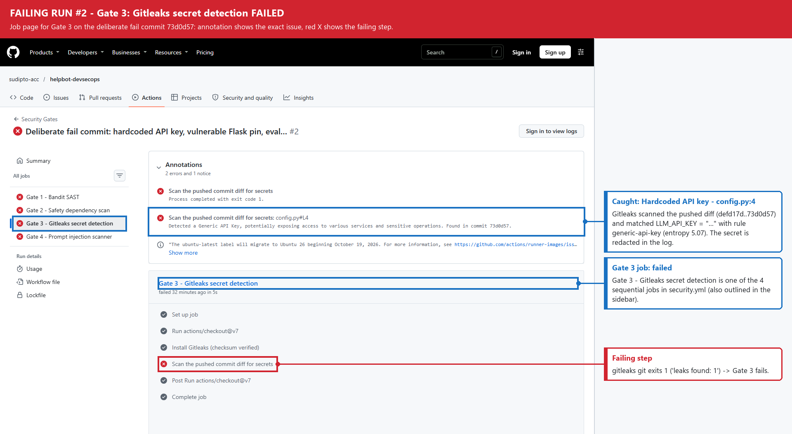
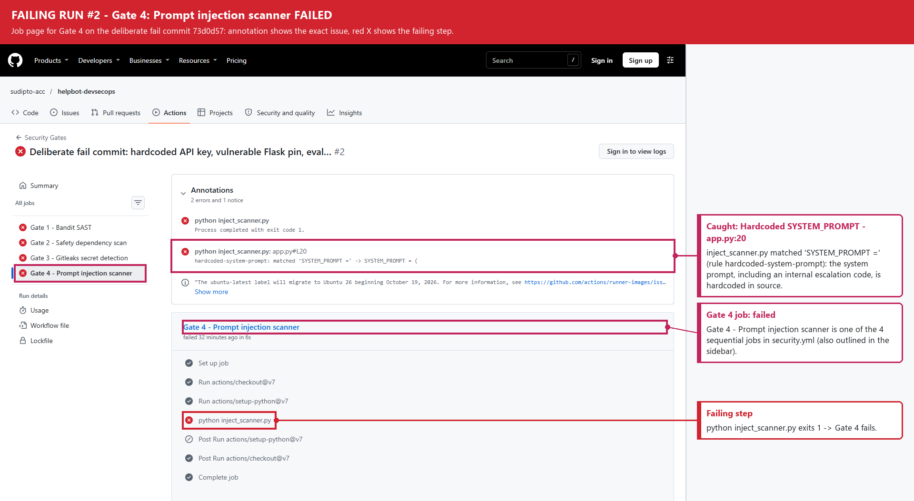
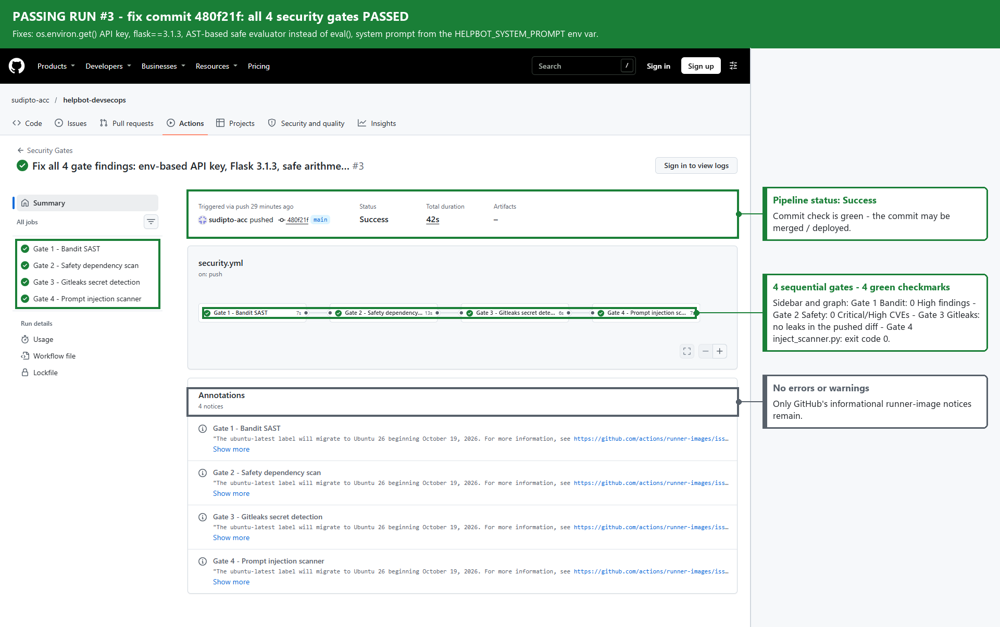

# Pipeline Design — DevSecOps Pipeline with AI-Specific Security Gates

## 1. Overview
The workflow [`.github/workflows/security.yml`](../.github/workflows/security.yml) runs on **every
push** to any branch. It contains four security gates, implemented as four jobs chained with `needs:`,
so they always run strictly in sequence:



Gates 2–4 are declared with `if: ${{ !cancelled() }}`, so a gate still runs when an earlier gate failed.
One run therefore reports **every** problem in a commit instead of stopping at the first one. If any
gate fails, the workflow run (and the commit's status check) is red. Every blocking finding is also
published as a GitHub annotation (`::error file=…,line=…,title=Gate N …`). The run summary page then
lists which gate flagged which file and line.

| Gate | Tool (pinned) | Command | Fails the pipeline when |
|---|---|---|---|
| 1 | Bandit 1.9.4 | `bandit -r .` | any **High** severity finding |
| 2 | Safety 3.8.1 | `safety check -r requirements.txt` | any dependency CVE rated **Critical** or **High** |
| 3 | Gitleaks 8.30.1 (pinned SHA-256) | `gitleaks git --log-opts=<before>..<after>` | any API key / password / token rule matches in the pushed commit diff |
| 4 | [`inject_scanner.py`](../inject_scanner.py) | `python inject_scanner.py` | any hardcoded system prompt or prompt-injection phrase in a `.py` file (exit code 1) |

## 2. What each gate checks

### Gate 1 — Bandit SAST
Bandit parses every Python file in the repository into an AST and runs its checks: shell and SQL
injection, `subprocess` with `shell=True`, Flask `debug=True`, weak cryptography, unsafe
deserialisation (`pickle`, `yaml.load`), `eval`/`exec`, requests without timeouts, hardcoded
passwords and so on. The step prints the full human-readable report, then a policy step reads the JSON
report and fails on any finding with severity **HIGH**. Low and Medium findings are reported but don't
block.

**AI-specific policy:** Bandit rates `eval()` (B307) and `exec()` (B102) as MEDIUM, because in a
generic program their input may be trusted. In an LLM application their input is usually text the
model produced or the user typed. One prompt injection is then enough to run arbitrary Python on the
server (OWASP LLM05 *Improper Output Handling*). The gate therefore escalates B307 and B102 to HIGH and
labels the annotation `[AI policy: eval() escalated MEDIUM -> HIGH]`.

### Gate 2 — Safety dependency scan
`safety check -r requirements.txt` resolves every pinned package in `requirements.txt` against the
Safety vulnerability database and writes a JSON report. The free database often has no CVSS scores. So
a policy step resolves each CVE's severity from Safety's own CVSS data first, then the GitHub Advisory
Database, then NVD. The gate fails on **CRITICAL** or **HIGH**. Medium/Low CVEs are shown as warnings
only. A CVE whose severity can't be resolved (for example, an API outage), or a missing Safety report,
**fails closed**, so a dependency problem can't slip through unchecked.

### Gate 3 — Gitleaks secret detection
Gitleaks scans the **patch of every commit in the push** (`github.event.before..github.sha`, or the
full reachable history on a repository's first push). The Gitleaks binary is downloaded from the
official release and checked against a SHA-256 pinned in the workflow, so a tampered download fails the
gate. It applies its 150+ built-in rules: provider
API keys (OpenAI, AWS, GitHub, Slack, Stripe…), private keys, JWTs, passwords in connection strings,
and a generic high-entropy `*key*/*token*/*secret*/*password* = "…"` rule. Secrets are redacted in the
log (`--redact`), and each hit is annotated with its rule, file, line and commit. Only the pushed diff is
scanned, so a fix commit is judged on what it adds. A secret that was already pushed is still in Git
history and must be **revoked and rotated**; deleting the line doesn't make it safe.

### Gate 4 — Custom prompt-injection scanner (`inject_scanner.py`)
The scanner walks every `.py` file in the repository (skipping only virtual-environment and build
directories) and searches, case-insensitively, for:

| Rule | Patterns |
|---|---|
| `hardcoded-system-prompt` | `SYSTEM_PROMPT =`, `system_message =`, `"role": "system"` |
| `injection-phrase` | "ignore previous instructions", "you are now", "pretend you are", "act as if you have no restrictions" |

Each match is printed with file, line and matched text, and annotated in Actions. The script exits
**1 if any match is found, 0 if clean**. The patterns are stored as regular expressions (`\s+` between
words), so the scanner's own source contains no literal trigger string and is scanned like every other
file.

**Why these patterns matter for an AI app:** a hardcoded system prompt ships inside every build and
container image. It usually holds confidential business rules (and often credentials), and
prompt-extraction attacks can pull it out of the model (OWASP LLM07 *System Prompt Leakage*). Injection
phrases in source code show that jailbreak text is being built into prompts, test fixtures or
few-shot examples that will reach the model (OWASP LLM01 *Prompt Injection*).

## 3. The deliberate fail commit — what each gate caught
Repository: <https://github.com/sudipto-acc/helpbot-devsecops>

| Commit | Purpose | Pipeline result |
|---|---|---|
| `97c41d9` Initial commit: vulnerable HelpBot AI application | provided vulnerable AI app (no workflow yet) | — |
| `defd17d` Add DevSecOps security pipeline… | adds `security.yml` + `inject_scanner.py` | ✅ all 4 gates green — [run #1](https://github.com/sudipto-acc/helpbot-devsecops/actions/runs/42457265852) |
| `73d0d57` Deliberate fail commit… | plants all 4 problems at once | ❌ all 4 gates red — [run #2](https://github.com/sudipto-acc/helpbot-devsecops/actions/runs/42457462412) |
| `480f21f` Fix all 4 gate findings… | fixes all 4 problems | ✅ all 4 gates green — [run #3](https://github.com/sudipto-acc/helpbot-devsecops/actions/runs/42457643438) |

> **Operational note (runs #4 and #5).** After the docs commit, Gate 3 failed twice with no finding: the
> GitHub release CDN returned HTTP 504 when downloading Gitleaks (and its checksum file). The gate
> **failed closed**, so an unavailable scanner never counts as a pass. The fix keeps that behaviour and
> removes the fragile dependency: the workflow now downloads only the tarball, with retries, and checks it
> against a SHA-256 pinned in `security.yml` instead of a checksum file fetched from the same server.

| # | Planted problem | Location | Caught by | Evidence in the Actions log |
|---|---|---|---|---|
| 1 | `eval()` executes the expression the LLM returns in a `CALC:` tool call | `app.py:40` (`run_calculator`) | **Gate 1 — Bandit B307** | `Gate 1 Bandit B307: blacklist: Use of possibly insecure function - consider using safer ast.literal_eval. [AI policy: eval() escalated MEDIUM -> HIGH]` → `Gate 1 FAILED: 1 High severity finding(s)` |
| 2 | `flask==0.12.2` (known-vulnerable version) | `requirements.txt:2` | **Gate 2 — Safety** | `CVE-2023-30861 severity HIGH (CVSS 7.5)` (session cookie disclosure), `CVE-2018-1000656 severity HIGH (CVSS 7.5)` (JSON DoS), `CVE-2019-1010083 severity HIGH (CVSS 7.5)` (JSON DoS); `CVE-2026-27205 LOW` shown as a non-blocking warning → `Gate 2 FAILED: 3 Critical/High CVE(s)` |
| 3 | Hardcoded API key `LLM_API_KEY = "REDACTED"` | `config.py:4` | **Gate 3 — Gitleaks `generic-api-key`** (entropy 5.07) | `Gate 3 Gitleaks generic-api-key: Detected a Generic API Key, potentially exposing access to various services and sensitive operations. Found in commit 73d0d57.` → `Gate 3 FAILED` |
| 4 | Hardcoded `SYSTEM_PROMPT = (...)` with internal escalation code | `app.py:20` | **Gate 4 — `inject_scanner.py`** | `app.py:20 hardcoded-system-prompt: matched 'SYSTEM_PROMPT =' -> SYSTEM_PROMPT = (` → `[Gate 4] FAILED: 1 match(es)` (exit code 1) |

### The fix commit

| # | Fix | Gate result |
|---|---|---|
| 1 | `eval()` replaced by an AST-based evaluator that allows only numeric literals and `+ - * / // % **` (with exponent limits and a 100-character cap). `__import__('os')…`, attribute access, calls, names and strings are rejected | Gate 1 ✅ 0 High findings |
| 2 | `flask==0.12.2` → `flask==3.1.3` (latest; no known advisories) | Gate 2 ✅ 0 Critical/High CVEs |
| 3 | `LLM_API_KEY = os.environ.get("LLM_API_KEY", "")`; in CI/production the value comes from a GitHub Actions secret / secret manager | Gate 3 ✅ no leaks in the pushed diff |
| 4 | System prompt moved to the `HELPBOT_SYSTEM_PROMPT` environment variable, read at call time by `config.get_system_prompt()` | Gate 4 ✅ exit code 0 |

### Actions log excerpts — fail run #2
Viewing raw job logs on GitHub requires signing in, so the key lines of each failing job are copied
here from the run's job logs (timestamps removed; Gitleaks author/email fields omitted):
```text
# Gate 1 - Bandit SAST
>> Issue: [B307:blacklist] Use of possibly insecure function - consider using safer ast.literal_eval.
   Severity: Medium   Confidence: High
   CWE: CWE-78 (https://cwe.mitre.org/data/definitions/78.html)
   Location: ./app.py:40:11
40	    return eval(expression)
##[error]blacklist: Use of possibly insecure function - consider using safer ast.literal_eval. [AI policy: eval() escalated MEDIUM -> HIGH]
Gate 1 FAILED: 1 High severity finding(s) - see the Bandit report above.

# Gate 2 - Safety dependency scan
##[error]flask==0.12.2 CVE-2023-30861 severity HIGH (CVSS 7.5) via GitHub Advisory GHSA-m2qf-hxjv-5gpq; vulnerable <2.2.5; https://getsafety.com/v/55261/97c
##[error]flask==0.12.2 CVE-2018-1000656 severity HIGH (CVSS 7.5) via GitHub Advisory GHSA-562c-5r94-xh97; vulnerable <0.12.3; https://getsafety.com/v/36388/97c
##[error]flask==0.12.2 CVE-2019-1010083 severity HIGH (CVSS 7.5) via GitHub Advisory GHSA-5wv5-4vpf-pj6m; vulnerable <0.12.3; https://getsafety.com/v/38654/97c
##[warning]flask==0.12.2 CVE-2026-27205 severity LOW via GitHub Advisory GHSA-68rp-wp8r-4726; vulnerable <3.1.3; https://getsafety.com/v/86909/97c
Gate 2 FAILED: 3 Critical/High CVE(s) in requirements.txt - upgrade the affected package(s).

# Gate 3 - Gitleaks secret detection
Scanning pushed commits defd17d..73d0d57
Finding:     LLM_API_KEY = "REDACTED"
Secret:      REDACTED
RuleID:      generic-api-key
Entropy:     5.072140
File:        config.py
Line:        4
Commit:      73d0d5700476d7fe40d4b43f84e6c60624c29546
INF 1 commits scanned.
WRN leaks found: 1
##[error]Detected a Generic API Key, potentially exposing access to various services and sensitive operations. Found in commit 73d0d57.
Gate 3 FAILED: secret pattern(s) found in the pushed commits. Remove and rotate the secret, then load it with os.environ.get().

# Gate 4 - Prompt injection scanner
  FAIL app.py
       app.py:20  hardcoded-system-prompt: matched 'SYSTEM_PROMPT =' -> SYSTEM_PROMPT = (
  ok   config.py
  ok   inject_scanner.py
[Gate 4] FAILED: 1 match(es). Move system prompts out of source code (environment variable / secret store) and remove prompt-injection phrases.
```

### Screenshots
Annotated screenshots of the public run pages, captured with headless Edge. Each gate has its own
colour; the callouts name the specific issue that gate caught.

**Failing pipeline run #2 — which gate caught which issue**



| Gate 1 — Bandit | Gate 2 — Safety |
|---|---|
|  |  |
| **Gate 3 — Gitleaks** | **Gate 4 — inject_scanner.py** |
|  |  |

**Clean passing pipeline run #3 — all 4 gates green**



## 4. Why detecting these issues at commit time keeps them out of production
Each of these four problems is cheapest to fix minutes after it is written and most expensive once it
is running. Running the gates on every push turns each commit into a checkpoint. The workflow result is
attached to the commit as a status check. With branch protection on `main` set to require the
*Security Gates* checks, a red commit cannot be merged, built into an artifact or picked up by a
deployment job. So the `eval()`, the vulnerable Flask, the leaked key and the hardcoded prompt never
leave the developer's branch. Commit-time scanning also catches problems that are hard or impossible to
undo later. A secret pushed to Git is effectively public as soon as it lands, because forks, clones,
caches and CI logs copy it; scanning the diff flags it immediately, so the key can be revoked before
anyone abuses it. A system prompt in source code ships inside every build and container layer, where
prompt-extraction attacks can retrieve it. An `eval()` fed by model output turns a single prompt
injection into server-side code execution that no runtime WAF can see. A vulnerable dependency pinned
today is deployed to every environment tomorrow. Because the feedback arrives within minutes and points
to the exact gate, file, line and commit, the developer who introduced the problem fixes it while the
context is fresh. Otherwise a pentester, a bug-bounty hunter or an attacker finds it after release,
under incident pressure, with emergency patches and credential rotation across every environment.
